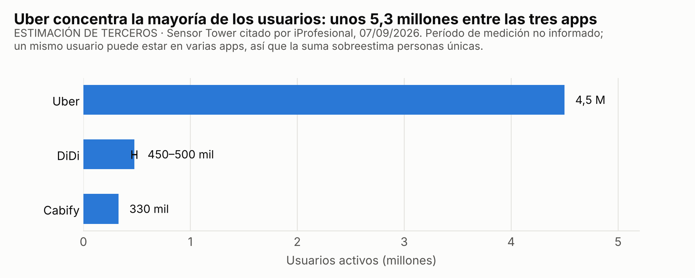
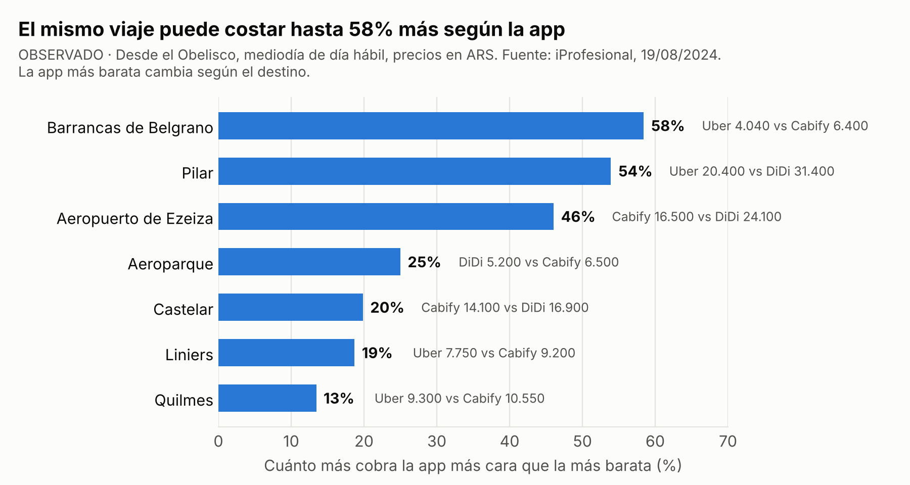
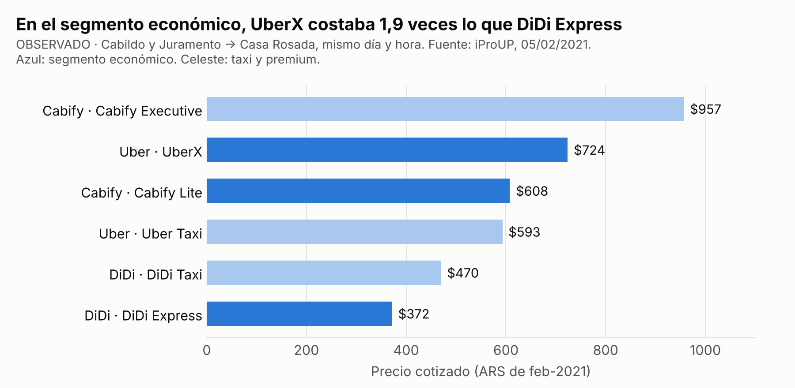
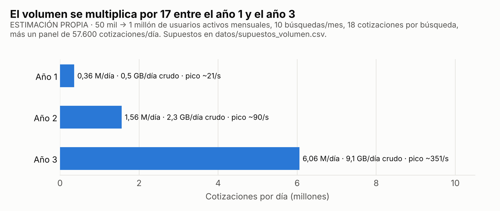
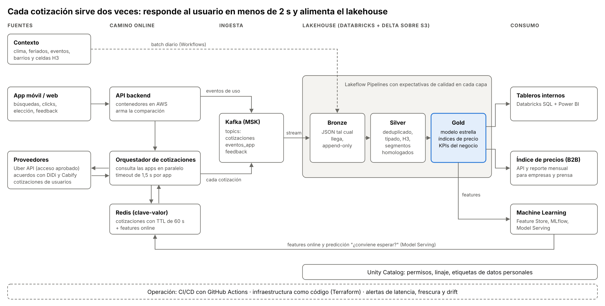
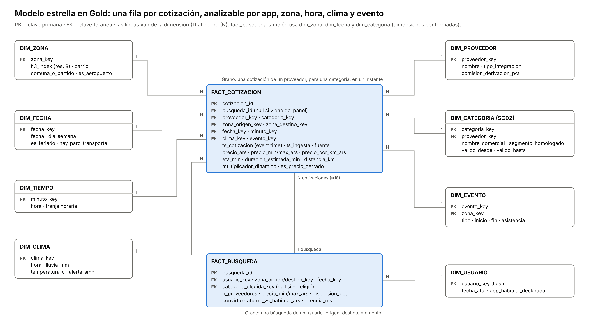
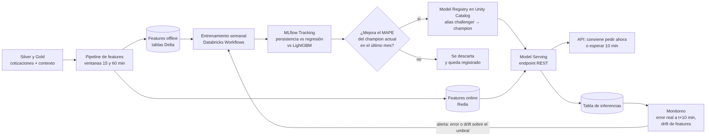

# Comparador de tarifas de apps de movilidad en el AMBA

**Trabajo Práctico Final — Big Data y MLOps (2026)**
Variante 1 — Investigación: caso de negocio y arquitectura de datos, con la extensión opcional de MLOps.
Autor: Federico Kosoy · Octubre de 2026

---

## Resumen

En el AMBA conviven tres apps de viajes (Uber, DiDi y Cabify) que cotizan precios distintos para el mismo viaje. Un relevamiento publicado en 2024 encontró diferencias de entre 13% y 58% para el mismo recorrido y a la misma hora, y la app más barata cambiaba según el destino. Hoy el pasajero que quiere el mejor precio abre las tres apps una por una.

Este trabajo propone una empresa hipotética, **RutaJusta**, con una app en la que el usuario carga origen y destino y ve, en menos de dos segundos, todas las opciones de las tres empresas comparadas por precio, tiempo de espera y categoría. Después elige y se le abre la app correspondiente. Cada cotización que pasa por el sistema se guarda en un lakehouse sobre Databricks, que alimenta tableros internos, un índice de precios de movilidad que se vende a empresas y un modelo de machine learning que recomienda si conviene pedir ahora o esperar unos minutos.

### Cómo leer los números

| Etiqueta | Significado |
| --- | --- |
| **[OBSERVADO]** | Dato publicado por una fuente externa identificada (ver Referencias). |
| **[ESTIMACIÓN DE TERCEROS]** | Cifra publicada, pero que la propia fuente presenta como estimación. |
| **[SUPUESTO]** | Valor propio, elegido para dimensionar la propuesta. No proviene de datos observados. |

---

## 1. Necesidad de negocio

### 1.1 Contexto

- **Mercado.** Según Sensor Tower, citado por iProfesional en septiembre de 2026, Uber supera los 4,5 millones de usuarios activos en Argentina, DiDi tiene entre 450.000 y 500.000 y Cabify ronda los 330.000 [ESTIMACIÓN DE TERCEROS]. Uber declara más de 310.000 conductores activos y DiDi unos 180.000 registrados. La misma nota aclara que "no hay datos públicos exactos".
- **Precios dinámicos.** Las tres apps fijan el precio según la demanda, el horario, la zona y la cantidad de autos disponibles. El precio de un mismo viaje cambia de un minuto a otro y entre apps.
- **Regulación.** En mayo de 2026, la Cámara en lo Contencioso Administrativo porteña resolvió que los conductores de estas plataformas deben cumplir los requisitos de taxis y remises (licencia profesional y seguros). El fallo no prohíbe las apps, pero sí la publicidad de aplicaciones no reguladas en espacios públicos. La medida rige hasta que la Legislatura sancione una ley específica [OBSERVADO, Infobae 08/05/2026].

*Figura 1. Usuarios activos por app en Argentina [ESTIMACIÓN DE TERCEROS]. Un mismo usuario puede tener varias apps, así que la suma (≈5,3 millones) sobreestima las personas únicas.*

### 1.2 Problema actual

El precio de un mismo viaje varía mucho entre apps, y **ninguna app es siempre la más barata**:

- En agosto de 2024, iProfesional cotizó viajes desde el Obelisco al mediodía de un día hábil. Las diferencias entre apps fueron de 13% a 58% según el destino. La app más barata fue Uber en cuatro destinos, Cabify en dos y DiDi en uno (Figura 2) [OBSERVADO].
- En febrero de 2021, para un mismo viaje y a la misma hora, UberX cotizó 1,9 veces lo que DiDi Express (Figura 3) [OBSERVADO].
- El ranking también cambia con el horario. A las 20 h, respecto del mediodía, Uber subió hasta 67% hacia Plaza Italia, mientras DiDi bajó más de 30% hacia Ezeiza [OBSERVADO].

*Figura 2. Diferencia entre la app más cara y la más barata para el mismo viaje [OBSERVADO]. La nota publica dos de las tres apps por destino.*

*Figura 3. Precios cotizados para un mismo viaje en distintas categorías [OBSERVADO, pesos de 2021].*

Hoy la comparación es manual: el pasajero abre dos o tres apps, espera que cada una cotice y compara a ojo. Eso tiene tres costos:

1. **Tiempo:** se hace en la vereda, apurado y muchas veces con mala señal.
2. **Precios que caducan:** cuando abrió la tercera app, la primera cotización puede haber cambiado.
3. **Comparaciones que no son equivalentes:** "UberX", "DiDi Express" y "Cabify Lite" no tienen el mismo nombre ni exactamente el mismo servicio.

Por eso la mayoría directamente no compara, y paga de más.

### 1.3 Usuarios y áreas involucradas

| Actor | Qué necesita | Qué le da la propuesta |
| --- | --- | --- |
| Pasajero (AMBA) | Pagar menos y decidir rápido | Comparación en una pantalla, con categorías equivalentes |
| Empresas con viajes corporativos | Controlar el gasto en movilidad | Reportes de ahorro y política de "la opción más barata" |
| Proveedores (Uber, DiDi, Cabify) | Captar viajes | Un canal de derivación que paga por viaje (afiliación) |
| Prensa, consultoras, sector público | Medir cómo evolucionan las tarifas | Índice de precios de movilidad por zona y franja |
| Áreas internas: Producto, Data, Comercial, Legal | Operar, medir y vender | Tableros, modelo de datos único, trazabilidad |

### 1.4 Objetivo y propuesta

**Objetivo:** que un pasajero del AMBA vea en menos de 2 segundos las opciones de las tres apps para su viaje, comparadas en forma justa, y pueda pedir la mejor con un toque.

La propuesta tiene cuatro piezas:

1. **App comparadora (B2C):** el usuario ingresa origen y destino y recibe cotización, tiempo de espera y categoría de cada proveedor, agrupadas por segmento equivalente (económico, confort, taxi, premium). Al elegir, se abre la app del proveedor con el viaje precargado (*deep link*).
2. **Recomendación temporal:** un modelo indica si conviene pedir ahora o esperar unos minutos (ver la sección 7).
3. **Índice de precios de movilidad (B2B):** un reporte y una API con la evolución de precios por zona, franja y proveedor.
4. **Ingresos:** comisión por viaje derivado (afiliación), suscripción B2B al índice y plan corporativo [SUPUESTO comercial].

### 1.5 Beneficios esperados

- **Pasajero:** menos gasto por viaje y menos tiempo para decidir.
- **RutaJusta:** ingresos por derivación y un activo de datos que nadie más tiene, porque son precios comparables de las tres apps en el tiempo.
- **Mercado:** más transparencia de precios y más competencia entre plataformas.

### 1.6 Cómo se evalúa el éxito

| KPI | Definición | Meta año 1 [SUPUESTO] | Dónde se mide |
| --- | --- | --- | --- |
| Ahorro mediano por viaje | (precio en la app habitual del usuario − precio elegido) / precio en la app habitual, en búsquedas que convirtieron | ≥ 10% | `fact_busqueda` |
| Tasa de conversión | Búsquedas que terminan en un deep link / búsquedas totales | ≥ 35% | `fact_busqueda` |
| Cobertura | Búsquedas con cotización de al menos 2 proveedores | ≥ 90% | `fact_busqueda.n_proveedores` |
| Latencia | Tiempo hasta mostrar la comparación, percentil 95 | ≤ 2 s | logs de la API → `fact_busqueda` |
| Frescura | Cotizaciones mostradas con menos de 60 s de antigüedad | ≥ 95% | Redis y `fact_cotizacion` |
| Retención | Usuarios que vuelven a buscar dentro de 30 días | ≥ 25% | `fact_busqueda` + `dim_usuario` |
| Calidad del modelo | Error (MAPE) a 10 min contra la línea base de persistencia | 10% menor | MLflow + tabla de inferencias |

La meta de ahorro (10%) es conservadora a propósito: las brechas observadas van de 13% a 58% (Figura 2), pero el usuario no siempre elige la más barata. La primera validación sería un piloto de 8 semanas con 2.000 usuarios, comparando contra su app habitual declarada.

---

## 2. Datos

### 2.1 Fuentes

| # | Fuente | Contenido | Formato | Frecuencia | ¿Disponible? | Sensibilidad |
| --- | --- | --- | --- | --- | --- | --- |
| 1 | API de Uber (*price estimates*) | Rango de precio por producto, moneda, duración, distancia (en millas) y multiplicador dinámico | JSON (REST) | Por búsqueda | **Existe y está documentada**; el uso en producción requiere que Uber apruebe el acceso | Baja |
| 2 | DiDi y Cabify | Precio, ETA y categoría | JSON | Por búsqueda | **[SUPUESTO]** No encontramos APIs públicas de cotización; se asume un acuerdo comercial (partnership) | Baja |
| 3 | Cotizaciones aportadas por usuarios | Precio que el usuario ve en la app del proveedor, cargado o confirmado por él | JSON | Por búsqueda (opcional) | [SUPUESTO] Función de la propia app; respaldo cuando falta el acuerdo | Media |
| 4 | Panel de muestreo | Cotizaciones periódicas de 200 pares origen-destino fijos | JSON | Cada 15 min | Depende de 1 y 2 | Baja |
| 5 | Eventos de la app | Búsqueda, cotizaciones mostradas, elección, deep link, feedback | JSON | Continuo | Propio (se genera al operar) | **Alta** (origen y destino) |
| 6 | Precio final reportado | Lo que el usuario pagó realmente (opcional) | JSON | Post-viaje | Propio | Media |
| 7 | Clima | Lluvia, temperatura y alertas por hora | API REST | Horaria | Disponible (servicios públicos y comerciales) | Ninguna |
| 8 | Calendario | Feriados, paros de transporte, partidos y recitales con su sede | CSV / carga manual | Diaria | Disponible (fuentes públicas) | Ninguna |
| 9 | Geografía | Barrios y comunas de CABA, partidos del conurbano, grilla H3 | GeoJSON | Anual | Disponible (datos abiertos) | Ninguna |

### 2.2 Volumen estimado

| Supuesto [SUPUESTO] | Año 1 | Año 2 | Año 3 |
| --- | --- | --- | --- |
| Usuarios activos mensuales | 50.000 | 250.000 | 1.000.000 |
| Búsquedas por usuario por mes | 10 | 10 | 10 |
| Cotizaciones por búsqueda (3 apps × 3 segmentos × 2 actualizaciones) | 18 | 18 | 18 |
| Cotizaciones del panel por día (200 pares × 3 apps × cada 15 min) | 57.600 | 57.600 | 57.600 |
| **Cotizaciones por día** | **0,36 M** | **1,56 M** | **6,06 M** |
| Volumen crudo (JSON ≈ 1,5 KB por cotización) | 0,5 GB/día | 2,3 GB/día | 9,1 GB/día (≈3,3 TB/año) |
| Pico (≈5 veces el promedio: viernes a la noche, lluvia) | ~21/s | ~90/s | ~350/s |

*Figura 4. Cotizaciones por día según el escenario [SUPUESTO]. Cálculo reproducible en `graficos/generar_graficos.py`.*

**Lectura honesta del volumen.** En el año 1, los datos entrarían en una base relacional común. Lo que justifica una arquitectura de Big Data desde el diseño es otra cosa:

- **Velocidad:** las cotizaciones caducan en un minuto y el precio cambia de una ventana de 5 minutos a la siguiente.
- **Crecimiento:** el volumen se multiplica por 17 en tres años.
- **Variedad:** el sistema combina JSON de varios proveedores, eventos de uso, clima, calendario y geodatos.
- **Machine learning:** el modelo se entrena con el histórico completo.

Esto se discute como compromiso en la sección 5.

### 2.3 Calidad

| Problema esperado | Ejemplo | Tratamiento |
| --- | --- | --- |
| Categorías no comparables | "UberX" vs "DiDi Express" vs "Cabify Lite" | Tabla de homologación a segmentos (`dim_categoria`, con historial SCD2) |
| Formatos distintos entre proveedores | Uber informa la distancia en millas y un rango de precio; otros informan precio cerrado | Normalización en Silver: km, ARS y punto medio del rango, más una marca de precio cerrado |
| Cotizaciones duplicadas | Reintentos y refrescos de pantalla | Deduplicación por `cotizacion_id` dentro del watermark |
| Datos que llegan tarde | Celular sin señal que envía eventos minutos después | Event time + watermark de 10 min |
| Precio cotizado ≠ precio pagado | Cambios de ruta, peajes, esperas | Feedback opcional del precio final; métrica de desvío |
| Cotizaciones de usuarios erróneas o falsas | Error de tipeo, fraude | Reglas de rango (precio por km plausible), reputación del usuario y cuarentena |
| GPS impreciso | El origen "salta" de cuadra | Agregación a celdas H3 |
| Inflación | Los pesos de hoy no se comparan con los de hace un año | Análisis en precios relativos (índice base 100 por mes) y el modelo predice variaciones, no niveles |

### 2.4 Sensibilidad y privacidad

Origen y destino de los viajes son **datos personales**: permiten inferir domicilio, trabajo y hábitos. Se tratan bajo la Ley 25.326 de Protección de Datos Personales:

- **Minimización:** las coordenadas exactas solo viven en memoria y en Redis, con un TTL de 60 s. En Silver se reemplazan por celdas H3 de resolución 9 y en Gold por celdas de resolución 8.
- **Seudonimización:** `usuario_key` es un hash con sal; nombre, email y teléfono quedan en la base operativa, fuera del lakehouse.
- **Sin credenciales de terceros:** RutaJusta nunca pide al usuario su usuario y contraseña de Uber, DiDi o Cabify.
- **Control de acceso:** columnas etiquetadas como personales en Unity Catalog, con acceso solo por rol.
- **Retención:** Bronze 90 días; Silver y Gold sin plazo, porque ya no contienen datos identificables.

### 2.5 Restricciones

- **Acceso a los precios:** es el principal riesgo del negocio. La API de Uber existe, pero los permisos de producción requieren aprobación. Para DiDi y Cabify se asume un acuerdo comercial. **No se hace scraping de las apps**, porque viola sus términos de uso y es frágil. Si un proveedor no da acceso, se usan cotizaciones aportadas por los usuarios, marcadas como tales.
- **Límites de consultas (rate limits):** condicionan el tamaño del panel de muestreo, y por eso es de 200 pares y no de miles.
- **Regulación:** el fallo de mayo de 2026 prohíbe la publicidad de apps no reguladas en espacios públicos. Esto restringe el marketing de RutaJusta si promociona servicios de plataformas que no estén habilitadas.
- **Costo:** el cómputo de streaming corre todo el día, por lo que hay que dimensionarlo con cuidado (ver la sección 5).

### 2.6 Qué está disponible y qué es supuesto

| Disponible hoy | Supuesto |
| --- | --- |
| Documentación de la API de Uber; datos de clima, calendario y geografía; relevamientos de precios publicados (2021 y 2024); estimaciones de usuarios por app (2026) | Acuerdos con DiDi y Cabify; aprobación de Uber; cantidad de usuarios, búsquedas y cotizaciones; tamaño del JSON; comisiones; metas de los KPIs |

---

## 3. Arquitectura propuesta

*Figura 5. Recorrido de los datos desde las fuentes hasta el consumo.*

### 3.1 Recorrido de un dato

1. **Búsqueda (camino online).** La app envía origen y destino a la API backend, que corre en contenedores en AWS (región São Paulo, la más cercana a Buenos Aires). El orquestador consulta a los tres proveedores en paralelo, con un tiempo máximo de 1,5 s por proveedor. Antes de consultar, revisa Redis: si hay una cotización de menos de 60 s para el mismo par de celdas H3, proveedor y categoría, la reutiliza. Así baja la latencia y se cuidan los límites de consulta.
2. **Respuesta.** La API arma la comparación por segmento equivalente y le agrega la recomendación del modelo ("pedí ahora" o "esperá 10 min"). Si el usuario elige, se abre el deep link del proveedor.
3. **Publicación de eventos.** Cada cotización y cada evento de uso se publican en Kafka (Amazon MSK), en los topics `cotizaciones`, `eventos_app` y `feedback`. El camino online no espera al lakehouse: si Databricks se demora, el usuario no lo nota.
4. **Bronze.** Un pipeline de Lakeflow (Structured Streaming) lee Kafka y guarda cada mensaje tal cual llegó, con su metadata (offset, partición, hora de ingesta). Es solo de agregado (append-only) y está particionado por fecha de ingesta.
5. **Silver.** Se parsea el JSON, se deduplica, se tipa, se normaliza (km, ARS), se homologan las categorías, se convierten las coordenadas a H3 y se aplican controles de calidad. Ver `sql/pipeline_bronze_silver_boceto.py`.
6. **Gold.** Se arma el modelo estrella (`fact_cotizacion`, `fact_busqueda` y sus dimensiones) y los agregados, como el índice de precios en ventanas de 5 minutos.
7. **Contexto (batch).** Clima, calendario y geografía entran una vez por día con Databricks Workflows.
8. **Consumo.** Tableros internos en Databricks SQL y Power BI; el índice B2B como API y reporte mensual; y features e histórico para ML.

### 3.2 Tecnologías por función

| Función | Tecnología | Rol en el caso |
| --- | --- | --- |
| Ingesta online | API en contenedores (AWS) + orquestador asíncrono | Consulta a proveedores y arma la respuesta |
| Caché y features online | Redis (Amazon ElastiCache) | Cotizaciones con TTL de 60 s; features para el modelo en milisegundos |
| Mensajería | Kafka (Amazon MSK) | Desacopla el camino online del analítico; permite releer el pasado |
| Almacenamiento | S3 + Delta Lake | Lakehouse con ACID, time travel y control de esquema |
| Procesamiento | Spark Structured Streaming en Databricks (Lakeflow Declarative Pipelines) | Bronze → Silver → Gold en streaming, con expectativas de calidad |
| Orquestación | Databricks Workflows | Cargas batch de contexto, agregados diarios y reentrenamiento |
| Calidad | Expectativas de Lakeflow + monitoreo de tablas | Reglas por capa; métricas de calidad en el registro de eventos del pipeline |
| Gobierno | Unity Catalog | Permisos por rol, linaje automático, etiquetas de datos personales |
| Visualización | Databricks SQL + Power BI | KPIs del negocio, índice de precios, monitoreo |
| ML | Feature Store, MLflow, Model Serving | Ver sección 7 |
| Operación | GitHub Actions, Terraform, alertas | CI/CD de código y pipelines; infraestructura como código |
| Base operativa (OLTP) | PostgreSQL | Cuentas, favoritos y preferencias: datos transaccionales y con datos personales |

### 3.3 Por qué Kappa y no Lambda

Todo dato de negocio entra por Kafka y se procesa en streaming. Para recalcular, por ejemplo si cambia una regla de homologación, se reprocesa desde Bronze, que guarda todo lo que llegó. Una arquitectura Lambda obligaría a mantener dos implementaciones de la misma lógica, una batch y otra streaming. Con Spark Structured Streaming y Delta, el mismo código sirve para las dos cosas. El único batch es el de los datos de contexto, que naturalmente llegan una vez por día.

---

## 4. Modelado de datos

### 4.1 Tablas por capa

| Capa | Tabla | Grano (una fila es…) | Clave | Partición |
| --- | --- | --- | --- | --- |
| Bronze | `bronze_cotizaciones` | un mensaje de Kafka | (partición, offset) | fecha de ingesta |
| Bronze | `bronze_eventos_app` | un evento de la app | (partición, offset) | fecha de ingesta |
| Silver | `silver_cotizaciones` | una cotización única y válida | `cotizacion_id` | fecha de cotización |
| Silver | `silver_busquedas` | una búsqueda con su resultado | `busqueda_id` | fecha |
| Gold | `fact_cotizacion` | una cotización de un proveedor, para una categoría, en un instante | `cotizacion_id` | `fecha_key` |
| Gold | `fact_busqueda` | una búsqueda de un usuario | `busqueda_id` | `fecha_key` |
| Gold | `agg_indice_precio_5min` | ventana de 5 min × par de zonas × segmento × proveedor | compuesta | fecha |
| Gold | 8 dimensiones | ver Figura 6 | clave sustituta `*_key` | — |

### 4.2 Modelo estrella (Gold)

*Figura 6. Modelo dimensional de la capa Gold. El detalle de tipos está en `sql/modelo_gold.sql` y en `diagramas/modelo_datos_completo.png`.*

**Hechos**

- **`fact_cotizacion`** es el corazón del modelo. Cada fila guarda qué precio dio un proveedor, para qué categoría, entre qué zonas y en qué momento. Sus medidas son precio (cerrado o rango), precio por km, ETA, duración, distancia y multiplicador dinámico. `busqueda_id` es nulo cuando la cotización viene del panel de muestreo y no de un usuario.
- **`fact_busqueda`** resume cada búsqueda: cuántos proveedores respondieron, precio mínimo y máximo, dispersión, qué eligió el usuario, si convirtió, cuánto ahorró contra su app habitual y la latencia. Una búsqueda tiene unas 18 cotizaciones.

**Dimensiones**

| Dimensión | Para qué sirve | Detalle de diseño |
| --- | --- | --- |
| `dim_proveedor` | Comparar apps | Incluye tipo de integración y comisión |
| `dim_categoria` | Comparar cosas comparables | `segmento_homologado` agrupa UberX, DiDi Express y Cabify Lite como "Económico"; SCD2 porque las apps renombran categorías |
| `dim_zona` | Dónde | Celda H3 de resolución 8 (≈0,7 km²) con barrio, comuna o partido y marca de aeropuerto; se usa para origen y para destino (*role-playing*) |
| `dim_fecha` / `dim_tiempo` | Cuándo | Feriados y paros; franjas horarias; separadas para no multiplicar filas |
| `dim_clima` | Contexto | Una fila por hora: lluvia, temperatura, alerta |
| `dim_evento` | Contexto | Partidos, recitales y paros, con su zona y horario |
| `dim_usuario` | Quién (seudónimo) | Hash, fecha de alta, app habitual declarada; sin datos personales |

**Decisiones de diseño**

- **Grano fino (cotización):** permite cualquier agregación posterior: por app, zona, hora, clima o evento. Los agregados como el índice de 5 minutos se calculan una vez en Gold, no en cada tablero.
- **H3 en vez de coordenadas o barrios:** las celdas tienen tamaño parejo, se pueden agrupar en niveles (de resolución 9 a 8 a 7) y protegen la privacidad.
- **Dimensiones conformadas:** `fact_cotizacion` y `fact_busqueda` comparten zona, fecha y categoría, así que se pueden cruzar, por ejemplo para ver la conversión según la dispersión de precios de la zona.
- **Partición por fecha y clustering por zonas y proveedor:** las consultas típicas filtran por período y por par de zonas.

### 4.3 Cómo responde las preguntas de negocio

| Pregunta | Tablas | Cálculo |
| --- | --- | --- |
| ¿Qué app es más barata en cada zona y franja? | `agg_indice_precio_5min` + `dim_tiempo` + `dim_zona` | % de ventanas en que cada proveedor tuvo la mediana más baja del segmento (`sql/modelo_gold.sql`, P1) |
| ¿Cuánto ahorran los usuarios? (KPI principal) | `fact_busqueda` | Mediana de `ahorro_vs_habitual_ars` entre las búsquedas que convirtieron (P2) |
| ¿Cuánto sube el precio con lluvia o con un partido? | `fact_cotizacion` + `dim_clima` / `dim_evento` | Precio por km mediano con y sin lluvia o evento, por proveedor (P3) |
| ¿Conviene esperar? | `agg_indice_precio_5min` + modelo | Variación esperada del precio a 10 min (sección 7) |
| ¿Qué proveedor genera más ingresos? | `fact_busqueda` + `dim_categoria` + `dim_proveedor` | Viajes derivados × comisión por proveedor |
| ¿Cómo evolucionan las tarifas? (índice B2B) | `agg_indice_precio_5min` | Mediana mensual del precio por km, base 100 |

### 4.4 Estructura en Redis (clave-valor)

| Clave | Valor | TTL |
| --- | --- | --- |
| `cot:{h3_origen_r9}:{h3_destino_r9}:{proveedor}:{categoria}` | JSON con precio, ETA y hora de la cotización | 60 s |
| `feat:{h3_origen_r8}:{h3_destino_r8}:{segmento}` | Features online del modelo (mediana de 15 y 60 min, tendencia) | 5 min |

---

## 5. Justificación de las decisiones

| Decisión | Alternativa descartada | Motivo | Compromiso que se acepta |
| --- | --- | --- | --- |
| Lakehouse (Delta sobre S3) | Data warehouse clásico | Almacenamiento barato para JSON crudo, mismo dato para BI y ML, ACID y time travel para auditar | Más piezas que gobernar que un warehouse administrado |
| Databricks | Spark administrado a mano (EMR) | Lo vimos en la materia; integra streaming, calidad, catálogo, MLflow y serving en una plataforma | Dependencia de un proveedor y costo por DBU |
| Kafka entre el camino online y el lakehouse | Escribir directo desde la API a Delta | La API no debe depender de la disponibilidad del lakehouse; Kafka permite releer y sumar consumidores | Un componente más que operar |
| Arquitectura Kappa | Lambda | Una sola lógica de transformación; se reprocesa desde Bronze | El streaming es más complejo de testear que el batch |
| Redis para cotizaciones | Consultar siempre a los proveedores | Latencia por debajo de 2 s y menos consultas a las APIs | Precios de hasta 60 s de antigüedad; se muestra la hora de cada cotización |
| PostgreSQL para cuentas | MongoDB / DynamoDB | Datos transaccionales y relacionales (usuario, favoritos); ACID; volumen chico | Escala vertical; suficiente para este uso |
| Modelo estrella con grano de cotización | Tablas anchas por tablero | Responde preguntas nuevas sin rehacer el modelo; métricas definidas una sola vez | Tabla de hechos grande, que se resuelve con partición y clustering |
| H3 de resolución 8 en Gold | Coordenadas exactas | Privacidad y agregación pareja | Se pierde precisión por debajo de unos 700 m |
| Región AWS São Paulo | Región de EE. UU. | Menor latencia hacia Buenos Aires | Algunos servicios pueden costar más; hay que verificar disponibilidad en la región |
| Cotizaciones de usuarios como respaldo | Scraping de las apps | Legal y sostenible | Cobertura menor y datos menos confiables, marcados con `fuente = 'crowd'` |

**Escala.** Spark y Delta escalan horizontalmente: el año 3 (~6 M de cotizaciones por día, picos de unas 350 por segundo) está muy por debajo del límite de la plataforma. Kafka se dimensiona por particiones y Redis por memoria, unos pocos GB.

**Latencia.** Los dos caminos están separados. El online se mide en milisegundos (Redis y llamadas en paralelo). El analítico, en minutos: el índice se actualiza cada 5 minutos y los tableros con unos minutos de demora.

**Costo.** No se cuantifica en pesos o dólares porque depende de precios y acuerdos no relevados. Las palancas son claras:

- clusters con autoescalado o serverless;
- un trigger del streaming cada minuto en lugar de continuo durante la madrugada;
- retención de 90 días en Bronze;
- tablas Gold agregadas para que los tableros no escaneen el detalle.

**Seguridad.** Minimización y seudonimización de datos personales, permisos por rol en Unity Catalog, secretos en un gestor de secretos (nunca en el código) y cifrado en tránsito y en reposo.

**Operación.** Pipelines declarativos con calidad incluida, linaje automático, CI/CD e infraestructura como código. Un equipo chico puede operarlo.

**Compromiso principal.** En el año 1 esta arquitectura está sobredimensionada para el volumen. Se elige igual porque:

1. el volumen crece unas 17 veces en tres años;
2. el streaming es necesario desde el día 1 por la frescura de los precios;
3. migrar de una base relacional a un lakehouse más adelante es más caro que empezar con una configuración chica de Databricks.

### 5.1 Limitaciones

- **El negocio depende del acceso a los precios.** Si DiDi o Cabify no firman acuerdos, la comparación queda incompleta.
- **Los datos observados son pocos y viejos:** dos relevamientos periodísticos de 2021 y 2024, con pocas rutas, y la nota de 2024 publica solo dos apps por destino. Muestran que la dispersión existe, pero no permiten estimar su tamaño típico. Medirla bien es justamente lo que haría el piloto.
- **Las estimaciones de usuarios son de terceros,** con período y metodología no informados.
- **Las metas de los KPIs y los volúmenes son supuestos** y deberían ajustarse con el piloto.
- **El precio cotizado no siempre es el que se paga;** el feedback del precio final es opcional y tendrá baja cobertura.

---

## 6. Gráficos y diagramas

| Figura | Contenido | Tipo de dato |
| --- | --- | --- |
| 1 | Usuarios activos por app (2026) | ESTIMACIÓN DE TERCEROS |
| 2 | Diferencia de precio entre apps para el mismo viaje (2024) | OBSERVADO |
| 3 | Precios de un mismo viaje por categoría (2021) | OBSERVADO |
| 4 | Volumen de cotizaciones por escenario | SUPUESTO |
| 5 | Diagrama de arquitectura | Diseño propuesto |
| 6 | Diagrama del modelo de datos (estrella) | Diseño propuesto |
| 7 | Flujo de MLOps | Diseño propuesto |

Los gráficos se regeneran con `python graficos/generar_graficos.py` a partir de los CSV de `datos/`, que incluyen la fuente de cada valor.

---

## 7. Extensión MLOps: ¿pedir ahora o esperar?

### 7.1 Objetivo del modelo

Predecir **cuánto va a variar el precio** de cada proveedor y segmento para un par de zonas **en los próximos 10 minutos**, y con eso recomendar "pedí ahora" o "esperá 10 min, se espera una baja de aproximadamente X%". La recomendación aparece solo si la baja esperada supera un umbral (por ejemplo 8%) y el modelo tiene suficiente confianza.

- **Variable objetivo:** `y = precio(t + 10 min) / precio(t) − 1`, la variación relativa. Predecir variaciones y no precios en pesos hace al modelo robusto a la inflación.
- **Métrica técnica:** MAPE sobre el precio reconstruido, comparado contra la línea base de persistencia ("el precio no cambia").
- **Métrica de negocio:** de las veces que se recomendó esperar, en qué porcentaje el precio efectivamente bajó.

### 7.2 Features

| Grupo | Features | Fuente |
| --- | --- | --- |
| Viaje | distancia_km, duración estimada, zona de origen y destino (H3 r8), es_aeropuerto | `fact_cotizacion`, `dim_zona` |
| Tiempo | hora, día de la semana, feriado, minutos hasta la próxima hora pico | `dim_fecha`, `dim_tiempo` |
| Precio actual | precio actual del proveedor, multiplicador dinámico, ETA | cotización en curso |
| Mercado | precio de los otros proveedores ahora; mediana de la zona en los últimos 15 y 60 min; tendencia (pendiente de 15 min) | `agg_indice_precio_5min` |
| Contexto | lluvia actual y pronosticada, evento a menos de 2 km que empieza o termina en ±60 min, paro | `dim_clima`, `dim_evento`, `dim_fecha` |

Las features se definen una sola vez en el Feature Store. Las tablas offline (Delta) se usan para entrenar y las online (Redis) para predecir, así el modelo ve los mismos cálculos en los dos momentos.

### 7.3 Flujo de entrenamiento e inferencia

*Figura 7. Ciclo de vida del modelo.*

1. **Entrenamiento:** un job semanal de Databricks Workflows arma el dataset con los últimos 6 meses. La etiqueta sale del propio histórico: es el precio observado 10 minutos después para el mismo par de zonas, proveedor y segmento, tomado del panel o de otras búsquedas.
2. **Partición temporal:** se entrena con los meses 1 a 5 y se valida con el mes 6, con validación de origen móvil (*rolling origin*). Nunca se mezclan datos futuros en el entrenamiento.
3. **Modelos comparados:**
    - persistencia (línea base);
    - regresión lineal regularizada;
    - LightGBM.
4. **Puerta de calidad:** un modelo nuevo pasa a *challenger* solo si mejora el MAPE del modelo actual (*champion*) en el último mes, sin empeorar en las zonas de aeropuertos ni en las franjas pico.
5. **Despliegue:** el modelo registrado se sirve con Model Serving, primero en modo sombra durante una semana (predice, pero no se muestra) y después en un A/B test con el 10% de los usuarios.
6. **Inferencia:** el orquestador llama al endpoint con las features online de Redis; la respuesta se agrega a la comparación.

### 7.4 Seguimiento de experimentos (MLflow)

| Se registra | Ejemplos |
| --- | --- |
| Parámetros | algoritmo, hiperparámetros, ventana de entrenamiento, horizonte (10 min), umbral de recomendación |
| Datos | versión de las tablas Delta usadas (time travel), cantidad de filas, período |
| Métricas | MAPE y MAE global, por franja y por proveedor; precisión de "esperar"; mejora contra la persistencia |
| Artefactos | modelo serializado, importancia de features, gráfico de error por hora, firma de entrada y salida |
| Registro | Model Registry en Unity Catalog, con alias `champion` y `challenger` y linaje hasta las tablas de origen |

### 7.5 Monitoreo

- **Error real:** cada predicción se guarda en una tabla de inferencias. Diez minutos después se compara con el precio observado, y se calcula el MAPE móvil de 24 horas y de 7 días por proveedor y franja.
- **Data drift:** cambio en la distribución de las features (por ejemplo con PSI) contra la del entrenamiento. Es típico cuando un proveedor cambia su esquema de tarifas o entra una nueva categoría.
- **Concept drift:** la relación entre las features y la variación de precio cambia, por ejemplo tras una suba de tarifas o un cambio regulatorio. Se detecta porque el error crece aunque las features no cambien.
- **Alertas y reentrenamiento:** si el MAPE de 7 días supera en más del 20% al de validación, o el PSI de una feature clave supera 0,2, se dispara un reentrenamiento fuera de calendario y se avisa al equipo.
- **Métrica de negocio:** si la precisión de "esperar" cae por debajo del 60%, la recomendación se apaga automáticamente hasta tener un modelo mejor. Es preferible no recomendar a recomendar mal.

### 7.6 Riesgos del modelo

- **Efecto propio:** si muchos usuarios esperan al mismo tiempo, pueden mover la demanda. Es poco probable a esta escala, pero se monitorea.
- **Cobertura:** en zonas con pocas cotizaciones el modelo es menos confiable; ahí no se muestra recomendación.
- **Transparencia:** la recomendación se presenta como estimación ("se espera"), nunca como garantía.

---

## 8. Conclusión

La dispersión de precios entre apps de movilidad es real y desordenada: en los relevamientos publicados la diferencia llegó al 58% y la app más barata cambió con el destino y el horario. Un comparador resuelve un problema concreto del pasajero. Además, cada comparación genera un dato que no existe en otro lado: precios comparables de las tres apps a lo largo del tiempo.

La arquitectura propuesta separa un camino online rápido (Redis y llamadas en paralelo) de un camino analítico en streaming (Kafka, Databricks y Delta con medallion). Gobierna los datos personales desde el diseño y se apoya en un modelo estrella que responde las preguntas del negocio. El mayor riesgo no es técnico sino de acceso a los datos de los proveedores, y por eso el primer paso sería un piloto que valide los acuerdos, mida la dispersión real y ajuste los supuestos de este documento.

---

## Referencias

- iProfesional (07/09/2026). *Uber, DiDi o Cabify: qué app de viajes eligen los argentinos en distintas ocasiones según últimos estudios de mercado.* https://www.iprofesional.com/impuestos/463877-uber-didi-o-cabify-que-app-de-viaje-elegir-en-cada-ocasion
- iProfesional (19/08/2024). *Si tenés que viajar en Uber, Cabify o DiDi, te contamos cuál te conviene más, según los precios.* https://www.iprofesional.com/finanzas/411537-cual-es-precio-viajar-uber-cabify-didi-segun-horario
- iProUP (05/02/2021). *Uber, Cabify, DiDi, precios: cuál te da el mismo viaje más barato.* https://www.iproup.com/innovacion/19966-uber-cabify-didi-precios-cual-te-da-el-mismo-viaje-mas-barato
- iProfesional (04/09/2026). *Uber o Cabify: cuál se usa más, qué app conviene y por qué se elige una u otra.* https://www.iprofesional.com/finanzas/463791-uber-o-cabify-cual-se-usa-mas-que-app-conviene-y-por-que-se-elige-una-u-otra
- Infobae (08/05/2026). *Qué cambia para conductores de Uber, DiDi y Cabify en CABA tras el fallo de la Justicia porteña.* https://www.infobae.com/sociedad/2026/05/08/que-cambia-para-conductores-de-uber-didi-y-cabify-en-caba-tras-el-fallo-de-la-justicia-portena/
- Uber Developers. *Riders API — GET /v1.2/estimates/price.* https://developer.uber.com/docs/riders/references/api/v1.2/estimates-price-get
- Uber Developers. *FAQ (acceso a scopes privilegiados).* https://developer.uber.com/docs/faq
- Kleppmann, M. *Designing Data-Intensive Applications.* O'Reilly (bibliografía de la materia).
- Material de clase: Big Data (clase 1), Ecosistema y Arquitecturas, NoSQL, Streaming Data, MLOps.
